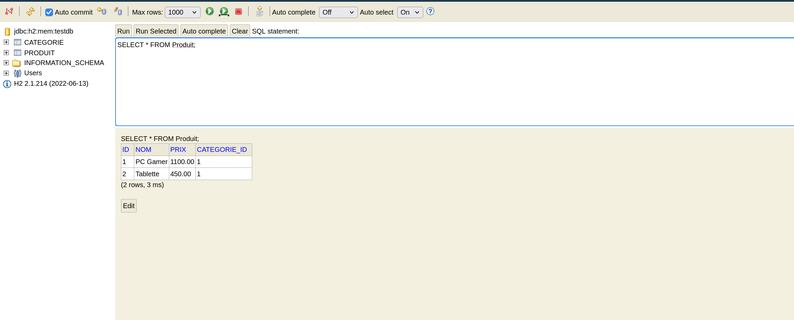
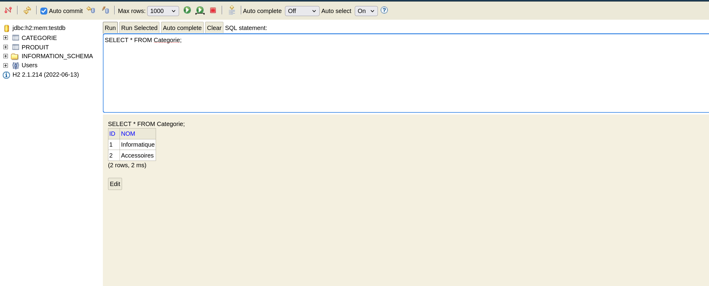

```console
Console H2 disponible sur : http://localhost:8082
Oct 10, 2026 12:08:59 PM org.hibernate.jpa.internal.util.LogHelper logPersistenceUnitInformation
INFO: HHH000204: Processing PersistenceUnitInfo [name: TP1]
Oct 10, 2026 12:08:59 PM org.hibernate.Version logVersion
INFO: HHH000412: Hibernate ORM core version 5.6.5.Final
Oct 10, 2026 12:08:59 PM org.hibernate.annotations.common.reflection.java.JavaReflectionManager <clinit>
INFO: HCANN000001: Hibernate Commons Annotations {5.1.2.Final}
Oct 10, 2026 12:08:59 PM org.hibernate.engine.jdbc.connections.internal.DriverManagerConnectionProviderImpl configure
WARN: HHH10001002: Using Hibernate built-in connection pool (not for production use!)
Oct 10, 2026 12:08:59 PM org.hibernate.engine.jdbc.connections.internal.DriverManagerConnectionProviderImpl buildCreator
INFO: HHH10001005: using driver [org.h2.Driver] at URL [jdbc:h2:mem:testdb;DB_CLOSE_DELAY=-1]
Oct 10, 2026 12:08:59 PM org.hibernate.engine.jdbc.connections.internal.DriverManagerConnectionProviderImpl buildCreator
INFO: HHH10001001: Connection properties: {user=sa, password=****}
Oct 10, 2026 12:08:59 PM org.hibernate.engine.jdbc.connections.internal.DriverManagerConnectionProviderImpl buildCreator
INFO: HHH10001003: Autocommit mode: false
Oct 10, 2026 12:08:59 PM org.hibernate.engine.jdbc.connections.internal.DriverManagerConnectionProviderImpl$PooledConnections <init>
INFO: HHH000115: Hibernate connection pool size: 20 (min=1)
Oct 10, 2026 12:09:00 PM org.hibernate.dialect.Dialect <init>
INFO: HHH000400: Using dialect: org.hibernate.dialect.H2Dialect
Oct 10, 2026 12:09:00 PM org.hibernate.resource.transaction.backend.jdbc.internal.DdlTransactionIsolatorNonJtaImpl getIsolatedConnection
INFO: HHH10001501: Connection obtained from JdbcConnectionAccess [org.hibernate.engine.jdbc.env.internal.JdbcEnvironmentInitiator$ConnectionProviderJdbcConnectionAccess@10dc7d6] for (non-JTA) DDL execution was not in auto-commit mode; the Connection 'local transaction' will be committed and the Connection will be set into auto-commit mode.
Hibernate:

    create table Categorie (
       id bigint generated by default as identity,
        nom varchar(255),
        primary key (id)
    )
Hibernate:

    create table Produit (
       id bigint generated by default as identity,
        nom varchar(255),
        prix numeric(19,2),
        categorie_id bigint,
        primary key (id)
    )
Hibernate:

    alter table Produit 
       add constraint FKejxvy5dl65jihv1v5k6v9vqd6 
       foreign key (categorie_id) 
       references Categorie
Oct 10, 2026 12:09:00 PM org.hibernate.engine.transaction.jta.platform.internal.JtaPlatformInitiator initiateService
INFO: HHH000490: Using JtaPlatform implementation: [org.hibernate.engine.transaction.jta.platform.internal.NoJtaPlatform]
Hibernate:
insert
into
Categorie
(id, nom)
values
(default, ?)
Hibernate:
insert
into
Produit
(id, categorie_id, nom, prix)
values
(default, ?, ?, ?)
Hibernate:
insert
into
Produit
(id, categorie_id, nom, prix)
values
(default, ?, ?, ?)
Hibernate:
insert
into
Categorie
(id, nom)
values
(default, ?)
Hibernate:
insert
into
Produit
(id, categorie_id, nom, prix)
values
(default, ?, ?, ?)
Données insérées avec succès !

--- Liste des Produits ---
Hibernate:
select
produit0_.id as id1_1_0_,
categorie1_.id as id1_0_1_,
produit0_.categorie_id as categori4_1_0_,
produit0_.nom as nom2_1_0_,
produit0_.prix as prix3_1_0_,
categorie1_.nom as nom2_0_1_
from
Produit produit0_
inner join
Categorie categorie1_
on produit0_.categorie_id=categorie1_.id
Produit{id=1, nom='PC Gamer', prix=1200.00, categorie=Informatique}
Produit{id=2, nom='Tablette', prix=450.00, categorie=Informatique}
Produit{id=3, nom='Clavier Mécanique', prix=80.00, categorie=Accessoires}

--- Recherche par Catégorie (JPQL) ---
Hibernate:
select
produit0_.id as id1_1_,
produit0_.categorie_id as categori4_1_,
produit0_.nom as nom2_1_,
produit0_.prix as prix3_1_
from
Produit produit0_ cross
join
Categorie categorie1_
where
produit0_.categorie_id=categorie1_.id
and categorie1_.nom=?
Trouvé en Informatique: PC Gamer
Trouvé en Informatique: Tablette
Hibernate:
select
produit0_.id as id1_1_0_,
produit0_.categorie_id as categori4_1_0_,
produit0_.nom as nom2_1_0_,
produit0_.prix as prix3_1_0_,
categorie1_.id as id1_0_1_,
categorie1_.nom as nom2_0_1_
from
Produit produit0_
left outer join
Categorie categorie1_
on produit0_.categorie_id=categorie1_.id
where
produit0_.id=?

Produit mis à jour : Produit{id=1, nom='PC Gamer', prix=1100.00, categorie=Informatique}
Hibernate:
select
produit0_.id as id1_1_0_,
produit0_.categorie_id as categori4_1_0_,
produit0_.nom as nom2_1_0_,
produit0_.prix as prix3_1_0_,
categorie1_.id as id1_0_1_,
categorie1_.nom as nom2_0_1_
from
Produit produit0_
left outer join
Categorie categorie1_
on produit0_.categorie_id=categorie1_.id
where
produit0_.id=?
Produit ID 3 supprimé.
Hibernate:
update
Produit
set
categorie_id=?,
nom=?,
prix=?
where
id=?
Hibernate:
delete
from
Produit
where
id=?
Oct 10, 2026 12:09:01 PM org.hibernate.engine.jdbc.connections.internal.DriverManagerConnectionProviderImpl$PoolState stop
INFO: HHH10001008: Cleaning up connection pool [jdbc:h2:mem:testdb;DB_CLOSE_DELAY=-1]
```




